

  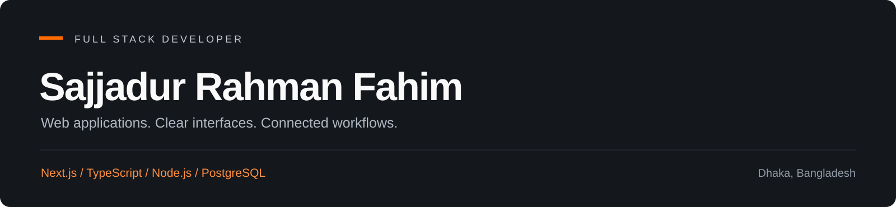

  <strong>Thoughtful interfaces. Connected workflows. Practical backend architecture.</strong>

  Full Stack Developer based in Dhaka, Bangladesh 
  Building applications across healthcare, education, commerce, and real-time communication.

  
  
  

  <a href="#about-me">About</a> &nbsp; / &nbsp;
  <a href="#technology-toolbox">Toolbox</a> &nbsp; / &nbsp;
  <a href="#project-showcase">Projects</a> &nbsp; / &nbsp;
  <a href="#lets-build-something">Contact</a>

---

## About me

I'm **Sajjadur Rahman Fahim**, a full stack developer who enjoys turning an idea into a complete web application: the interface people interact with, the API behind it, and the data relationships that keep it working.

My main stack is **Next.js, TypeScript, Node.js, Express, Prisma, and PostgreSQL**. I also work with NestJS, MongoDB, Redis, and real-time tooling where the project calls for them. My projects explore practical workflows such as booking a consultation, submitting an exam, managing an order, or keeping a conversation updated.

| What I work on | My focus |
| --- | --- |
| Frontend development | Responsive layouts, reusable components, forms, dashboards, and clear navigation |
| Backend development | Modular APIs, request validation, authentication, and role-based access |
| Data modeling | Relationships, application state, ownership rules, and query organization |
| Application integration | Connecting UI state, server data, uploads, email, payments, and real-time events |

**Currently exploring:** Go, database optimization, caching strategies, and real-time application architecture.

## Technology toolbox

  

| Layer | Technologies |
| --- | --- |
| Languages | TypeScript, JavaScript; exploring Go |
| Interfaces | React, Next.js, Tailwind CSS, shadcn/ui |
| State & forms | TanStack Query, TanStack Form, Redux Toolkit, Axios, Zod |
| APIs & services | Node.js, Express, NestJS, REST, GraphQL |
| Databases & caching | PostgreSQL, Prisma, MongoDB, Redis |
| Authentication | Better Auth, JWT, Firebase Authentication |
| Real-time communication | Socket.IO, WebSockets, LiveKit integration |
| Development & hosting | Git, GitHub, pnpm, Postman, Vercel, Firebase |

## Project showcase

Explore the live applications and their source code below. The previews show the real project interfaces; click an image to explore its live demo.

**Quick navigation:** [Doctorly](#01--doctorly) · [IELTSPrep](#02--ieltsprep) · [EVARA](#03--evara) · [Messenger](#04--messenger-app) · [Cinerate](#05--cinerate) · [MediStore](#06--medistore) · [More projects](#more-projects)

---

[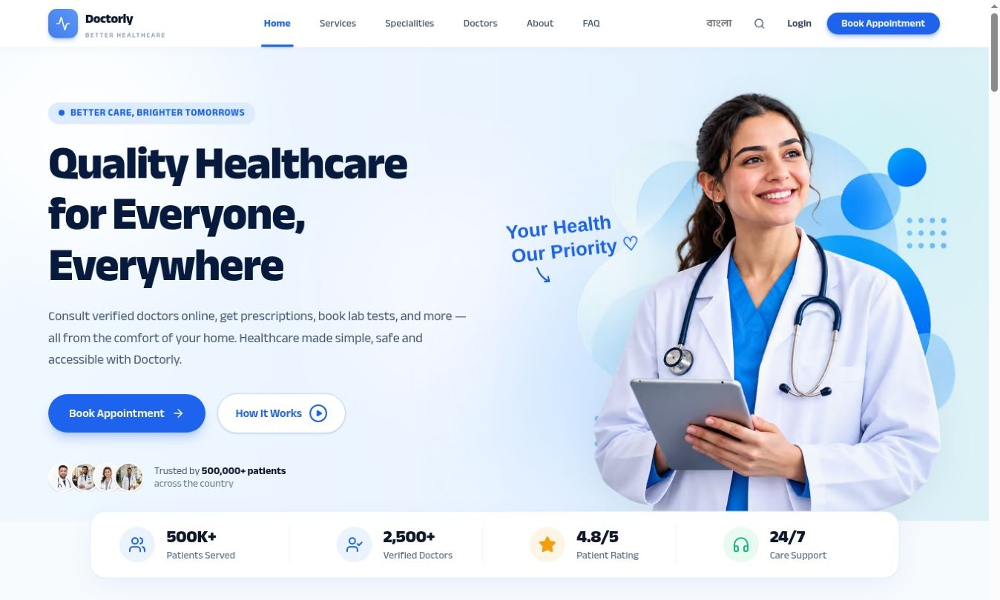](https://doctorly-fontend.vercel.app/)

### 01 · Doctorly

**Telemedicine & healthcare management**

Doctorly brings patient, doctor, and administrative workflows into one healthcare application. The project connects a patient-facing experience with backend modules for appointments, schedules, prescriptions, medical records, and payments.

**Key workflows**

- **Appointments:** Create bookings, retrieve appointment history and details, update appointment status, and cancel appointments.
- **Doctor availability:** Organize doctor profiles, specialties, and schedule relationships to support consultation booking.
- **Prescriptions:** Create and retrieve prescriptions, view a patient's prescription history, and manage prescription updates.
- **Supporting services:** Separate modules cover medical records, notifications, chat, calls, and payment operations.

**Engineering focus:** Modeling the relationships between patients, doctors, schedules, appointments, and prescriptions while passing authenticated user context into service operations. The backend uses modular Express controllers and services with Prisma-backed PostgreSQL data access.

**Stack:** `Next.js` `TypeScript` `Tailwind CSS` `TanStack Query` `Express` `Prisma` `PostgreSQL` `Better Auth` `Socket.IO`

**[Open live demo ↗](https://doctorly-fontend.vercel.app/)** · [Frontend source](https://github.com/Siiwowowow/Doctorly-Client) · [Backend source](https://github.com/Siiwowowow/Doctorly-Server)

---

[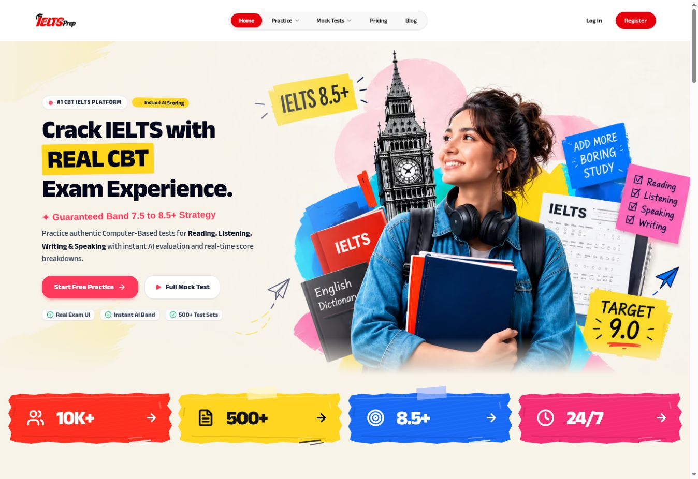](https://ielts-project-client.vercel.app/)

### 02 · IELTSPrep

**IELTS practice, mock tests & attempt review**

IELTSPrep organizes IELTS preparation around structured practice and exam attempts. It includes dedicated backend modules for Reading, Listening, Writing, Speaking, mock tests, vocabulary, and teacher administration.

**Key workflows**

- **Reading exams:** Model exams, passages, question groups, and questions with formats such as multiple choice, matching headings, and True / False / Not Given.
- **Attempt tracking:** Store submitted answers, correctness, attempt status, raw scores, and band-score fields for later review.
- **Speaking submissions:** Upload audio responses, submit attempts, retrieve attempt history, and support grading and review workflows.
- **Content ownership:** Teacher-facing exam management includes ownership checks when updating or deleting speaking exams.
- **Authentication infrastructure:** Better Auth and Redis storage support the account and session layer alongside the PostgreSQL application database.

**Engineering focus:** Separating reusable exam content from each learner's answers and attempt history. This keeps the question model independent from submissions and makes it easier to support multiple question types and review screens.

**Stack:** `Next.js` `TypeScript` `Express` `Prisma` `PostgreSQL` `Redis` `Better Auth` `Zod` `TanStack Query`

**[Open live demo ↗](https://ielts-project-client.vercel.app/)** · [Frontend source](https://github.com/Siiwowowow/IELTS-Project-Client) · [Backend source](https://github.com/Siiwowowow/IELTS-Project-Server)

---

[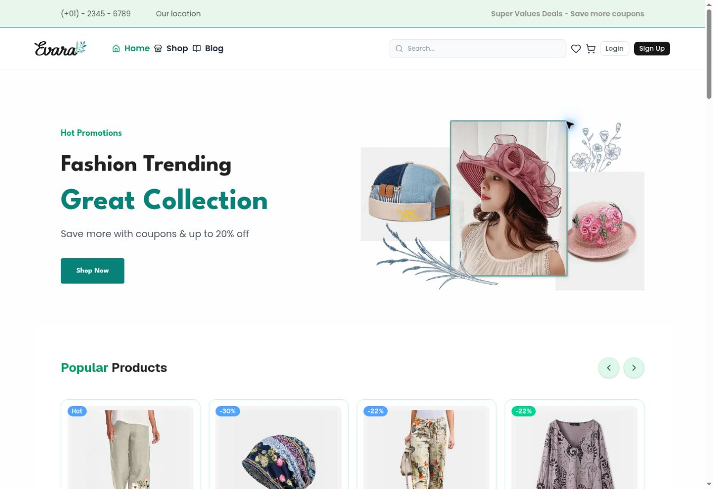](https://elvyn-cloth-client.vercel.app/)

### 03 · EVARA

**Product discovery & e-commerce catalog**

EVARA is an e-commerce project centered on presenting a product catalog and organizing the information shoppers need to compare items. Its linked backend models categories, products, and customer reviews as related records.

**Key workflows**

- **Product information:** Store descriptions, specifications, default and hover images, current and previous prices, and stock quantities.
- **Product options:** Represent available sizes and colors within the catalog model.
- **Merchandising:** Mark products as featured, popular, or newly added to support different storefront collections.
- **Reviews & categories:** Associate products with categories and link review ratings and comments to users and products.

**Engineering focus:** Designing a relational catalog that supports product presentation, merchandising flags, and customer feedback. The current linked server uses Express, TypeScript, and Prisma.

**Stack:** `Next.js` `TypeScript` `Express` `Prisma` `Better Auth` `Cloudinary` `Zod`

**[Open live demo ↗](https://elvyn-cloth-client.vercel.app/)** · [Frontend source](https://github.com/Siiwowowow/ELVYN-Client) · [Backend source](https://github.com/Siiwowowow/ELYVN-SERVER)

---

[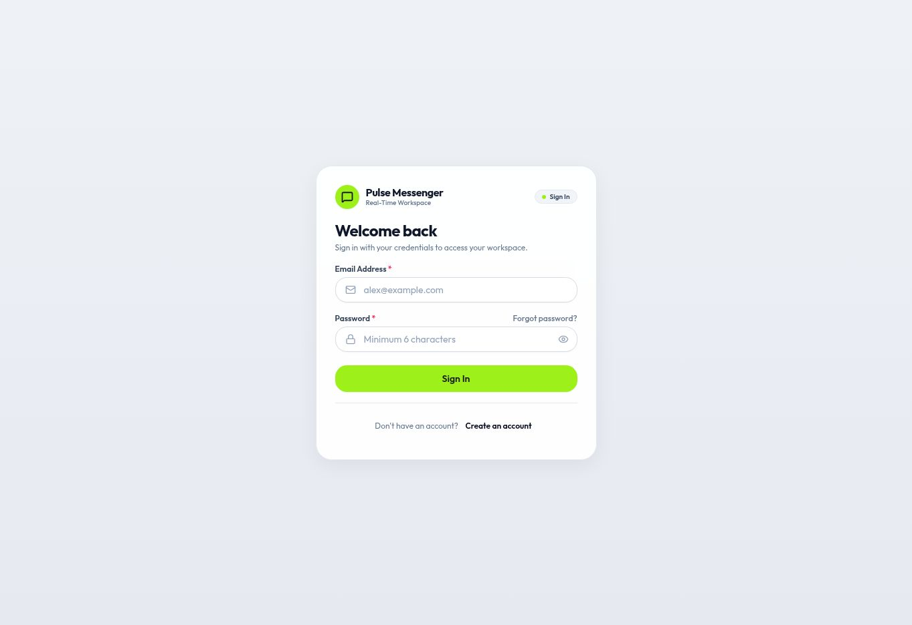](https://massange-fontend.vercel.app/)

Public sign-in screen. The messaging workspace requires an account.

### 04 · Messenger App

**Messaging, conversations & calling integration**

Messenger explores the application layers behind an interactive communication product: conversation membership, message history, presence, message requests, and calling. The current project pairs a Next.js client with a modular NestJS backend.

**Key workflows**

- **Conversations:** Create direct or group conversations, list a user's conversations, and retrieve participant information.
- **Membership:** Add or remove participants and leave a conversation through dedicated endpoints.
- **Messages:** Send, retrieve, edit, and delete messages within conversation-scoped APIs.
- **Presence & receipts:** Dedicated backend modules organize presence and message receipt handling.
- **Calling integration:** Start call signaling and request conversation-based LiveKit tokens; the client includes LiveKit components.

**Engineering focus:** Keeping conversation access, participant identity, message operations, and real-time updates connected. Communication-specific guards and project context are passed into backend services, while Redux Toolkit and TanStack Query support the client.

**Stack:** `Next.js` `TypeScript` `Redux Toolkit` `NestJS` `Prisma` `Socket.IO` `LiveKit` `GraphQL` `Zod`

**[Open live demo ↗](https://massange-fontend.vercel.app/)** · [Frontend source](https://github.com/Siiwowowow/Massenger-Client) · [Backend source](https://github.com/Siiwowowow/Massenger-Server)

---

[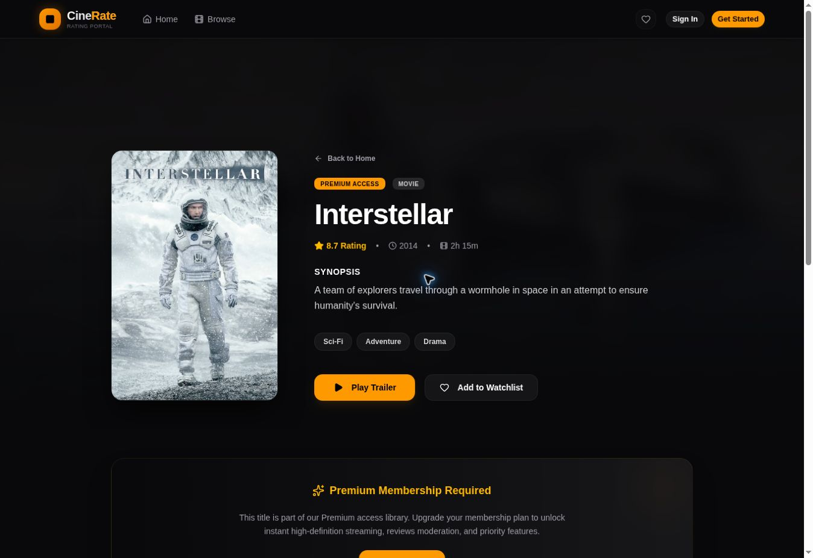](https://cinetube-client-azure.vercel.app/)

### 05 · Cinerate

**Movie discovery, ratings & community reviews**

Cinerate combines a movie and series catalog with user feedback and personal watchlists. Its backend connects media, genres, reviews, comments, likes, watchlists, and administrative records through Prisma and PostgreSQL.

**Key workflows**

- **Discovery:** Browse movies and series and organize titles through the media catalog.
- **Community interaction:** Submit ratings and reviews, participate through comments and likes, and maintain watchlists.
- **Review moderation:** Reviews move through pending, approved, or rejected states, with average ratings updated when review status changes.
- **Ownership rules:** The documented API restricts user review edits and deletions according to ownership and publication state.
- **Billing integration:** Stripe webhook handling supports subscription and payment-state synchronization.

**Engineering focus:** Modeling content and user interactions while keeping moderation state, rating calculations, and access rules consistent across related records.

**Stack:** `Next.js` `TypeScript` `Express` `Prisma` `PostgreSQL` `JWT` `Zod` `Cloudinary` `Stripe`

**[Open live demo ↗](https://cinetube-client-azure.vercel.app/)** · [Frontend source](https://github.com/Siiwowowow/Cinetube-Client) · [Backend source](https://github.com/Siiwowowow/Cinetube-Server)

---

[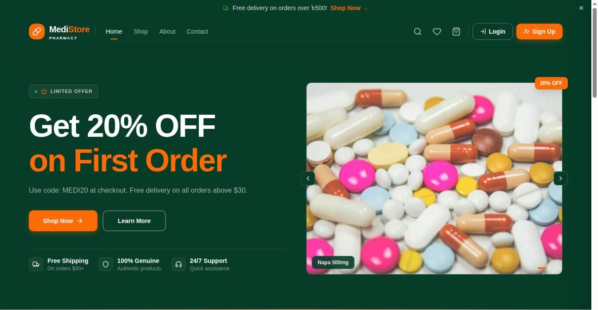](https://medistore-fontend.vercel.app/)

### 06 · MediStore

**Medicine marketplace with customer, seller & admin workflows**

MediStore organizes an online medicine marketplace around product discovery, shopping, and order management. Separate backend modules handle medicines, categories, carts, wishlists, reviews, sellers, dashboards, orders, and payments.

**Key workflows**

- **Shopping:** Browse medicine information and organize selections through cart and wishlist modules.
- **Customer orders:** Place orders, retrieve order details and history, filter by status, and request cancellations.
- **Seller operations:** Retrieve seller-specific orders, update order status, and access order statistics.
- **Administration:** Search and paginate orders, inspect associated customer and medicine information, and update statuses through admin operations.
- **Supporting integrations:** Prisma data access, authentication, media uploads, email, and Stripe dependencies support the surrounding services.

**Engineering focus:** Separating customer, seller, and administrative views of the same order lifecycle. The order controllers pass role and user context into the service layer and expose filtered, paginated lists.

**Stack:** `Next.js` `TypeScript` `Express` `Prisma` `PostgreSQL` `Better Auth` `JWT` `Zod` `Stripe`

**[Open live demo ↗](https://medistore-fontend.vercel.app/)** · [Frontend source](https://github.com/Siiwowowow/Medi-store-fontend) · [Backend source](https://github.com/Siiwowowow/Medi-store-backend)

## More projects

[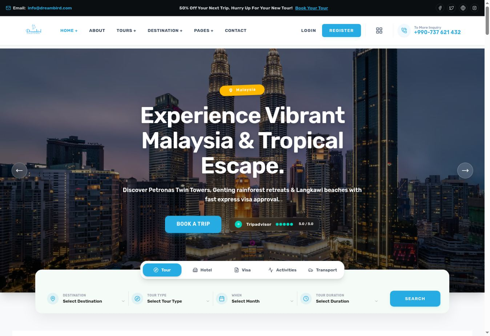](https://dream-bird-client.vercel.app/)

### 07 · DreamBird Tourism

**Travel discovery & service browsing**

A travel website bringing destination discovery and travel-service information into a responsive frontend. The current Next.js repository includes dedicated routes for destinations, tours, hotels, visa services, account access, and dashboards.

- Organizes travel content into destination, tour, hotel, and visa sections.
- Includes hotel detail and visa detail routes alongside about and contact pages.
- Provides account-related screens and separate user and admin dashboard routes.

**Engineering focus:** Structuring a travel site's route hierarchy and reusable interface components so visitors can move between discovery, service information, and their account.

**Stack:** `Next.js` `React` `TypeScript` `Tailwind CSS` `TanStack Query` `Axios` `Zod`

**[Open live demo ↗](https://dream-bird-client.vercel.app/)** · [Frontend source](https://github.com/Siiwowowow/Dream-Bird-Client) · [Backend source](https://github.com/Siiwowowow/Dream-Bird-Server)

---

[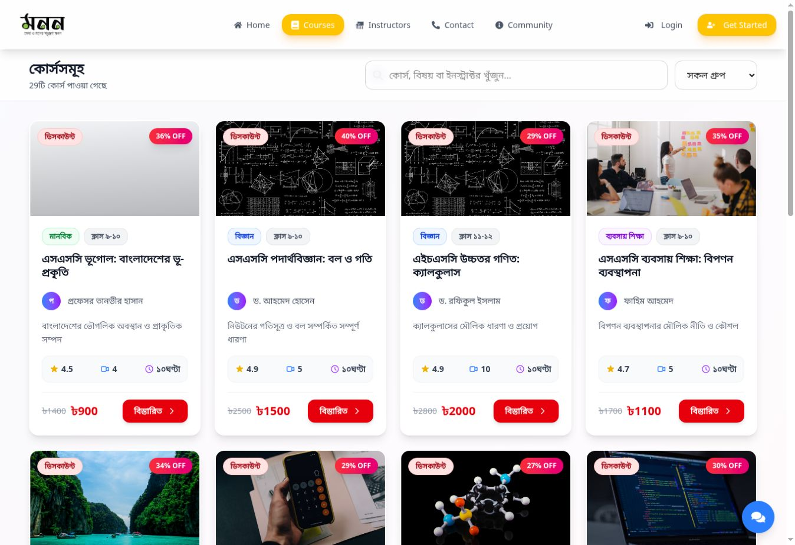](https://monon-academy.vercel.app/)

### 08 · Monon Academy

**Courses, lessons & learning dashboards**

Monon Academy is an online learning project for organizing course discovery and student learning experiences. Its route structure covers course details, lesson pages, enrollment, student assignments and exams, and teacher course and exam management.

- Course browsing, course details, and dedicated learning pages.
- Student dashboard routes for enrolled courses, assignments, exams, and profile management.
- Teacher-facing pages for creating courses, managing courses, and preparing MCQ and written exams.

**Engineering focus:** Organizing a role-oriented learning platform where course content, learning screens, and assessment management have distinct navigation and responsibilities.

**Stack:** `Next.js` `React` `JavaScript` `MongoDB` `Tailwind CSS` `TanStack Query`

**[Open live demo ↗](https://monon-academy.vercel.app/)** · [Source code](https://github.com/Siiwowowow/Monon-Academy-Lms-Project)

---

[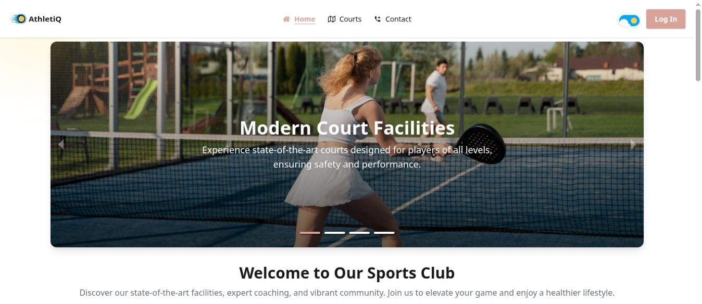](https://a-12-sport-org.web.app/)

### 09 · Sports Club Management

**Membership, bookings & club administration**

A sports club management project that brings member-facing activities and administrative tasks into a shared web application. The project covers membership, booking management, role-based dashboards, and payment integration.

- Member registration and access to club-related activities.
- Booking and scheduling workflows with administrative management screens.
- Firebase authentication and Stripe integration within the application stack.

**Engineering focus:** Connecting role-specific interfaces with the booking and payment workflows behind a club management application.

**Stack:** `React` `Firebase` `Stripe` `Tailwind CSS`

**[Open live demo ↗](https://a-12-sport-org.web.app/)** · [Source code](https://github.com/Siiwowowow/SPORTS-CLUB-MANAGEMENT-SYSTEM)

---

[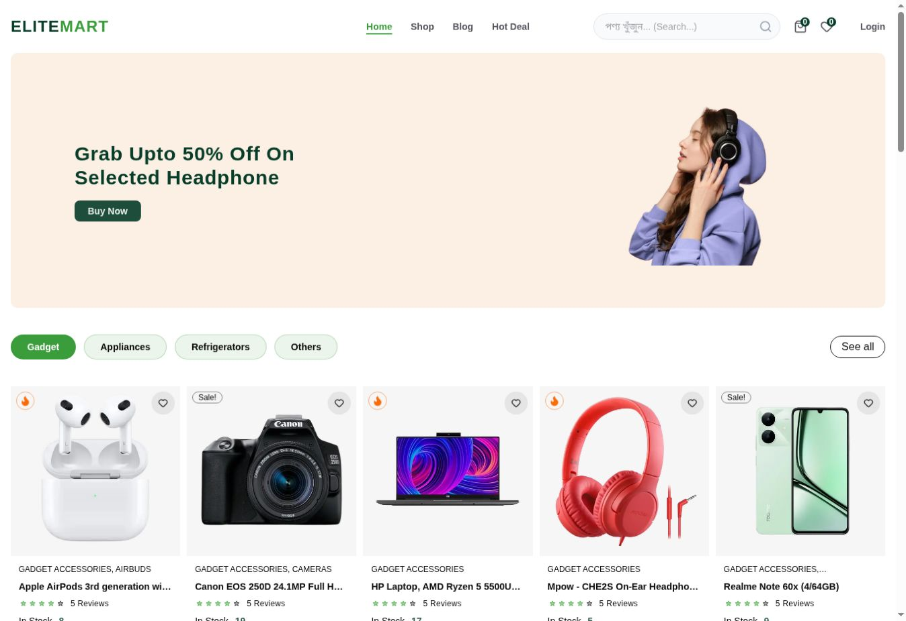](https://e-commerce-elite-mart.vercel.app/)

### 10 · Elite Mart

**Content-driven e-commerce storefront**

Elite Mart explores an online storefront powered by Next.js and Sanity. Its current application structure includes shop, product, category, brand, deal, blog, cart, wishlist, order, and purchase-success pages, with an embedded Sanity Studio route.

- Organizes product discovery through shop, category, brand, and deal pages.
- Includes cart, wishlist, and order screens within the customer journey.
- Uses Sanity tooling for content modeling and management, with Clerk and Stripe integrations in the project dependencies.

**Engineering focus:** Connecting CMS-managed catalog content with reusable storefront pages and client-side shopping state.

**Stack:** `Next.js` `TypeScript` `Sanity` `Clerk` `Zustand` `Tailwind CSS` `Stripe`

**[Open live demo ↗](https://e-commerce-elite-mart.vercel.app/)** · [Source code](https://github.com/Siiwowowow/E-commerce-Elite-Mart)

---

[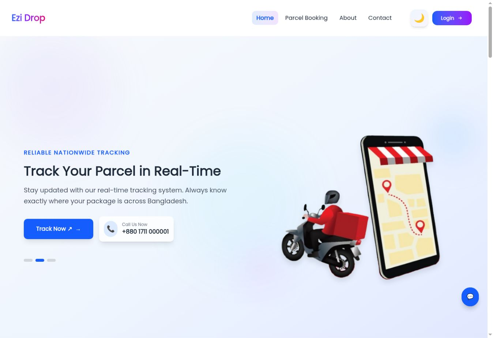](https://ezi-drop.vercel.app/)

### 11 · Ezi Drop

**Team project · Delivery & logistics**

Ezi Drop is a collaborative delivery platform focused on parcel workflows and communication between the people involved in a delivery. My contribution focused on dashboard interfaces, administrative parcel tools, and supporting integrations.

**My contributions**

- User dashboard interface and functionality, plus admin tools for parcel management.
- Chat functionality for communication between users and delivery riders.
- Weather API integration and authentication with role-based access.

**Engineering focus:** Contributing connected features within a team codebase and keeping dashboard actions aligned with delivery workflows.

**Stack:** `Next.js` `React` `TypeScript` `MongoDB` `Tailwind CSS`

**[Open live demo ↗](https://ezi-drop.vercel.app/)** · [Team repository](https://github.com/mahbub-alam-dave/ezi-drop)

---

[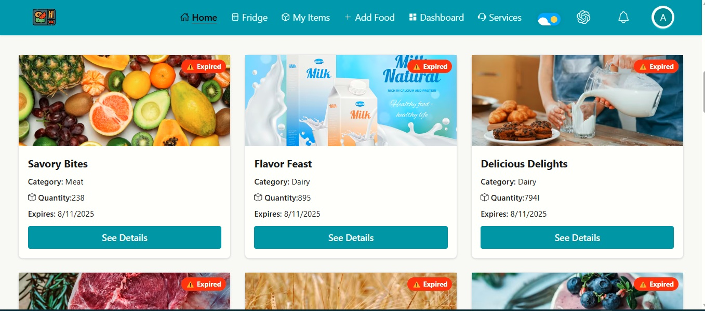](https://food-tracker-auth.web.app/)

Earlier project screenshot.

### 12 · Food Expiry Tracker

**Food inventory & expiry-date tracking**

A food organization project for recording food items and monitoring their expiry dates. The repository documents food management, expiry countdowns, personal notes, filtering, and user-specific access to item updates.

- Add, edit, and delete food records with categories, quantities, and expiry dates.
- View expiry countdowns and attach notes to personal food items.
- Filter and sort items while applying ownership checks to modification workflows.

**Engineering focus:** Combining CRUD operations, date-based UI feedback, and record ownership in an everyday application workflow.

**Stack:** `React` `Express` `MongoDB` `JWT` `TanStack Query` `Tailwind CSS`

**[Open live demo ↗](https://food-tracker-auth.web.app/)** · [Source code](https://github.com/Siiwowowow/Food-Tracker)

---

## Let's build something

I'm open to discussing **full stack development opportunities, project collaboration, and web application ideas**. If you're working on a product that needs a thoughtful interface and a practical backend, let's connect.

  <a href="mailto:fahimrahman0145@gmail.com"><strong>Email me ↗</strong></a> &nbsp; / &nbsp;
  <a href="https://www.linkedin.com/in/sajjadur-rahman-fahim-9384b3379"><strong>Connect on LinkedIn ↗</strong></a> &nbsp; / &nbsp;
  <a href="https://wa.me/8801601325068"><strong>WhatsApp ↗</strong></a>

Dhaka, Bangladesh · Next.js · TypeScript · Node.js · PostgreSQL

